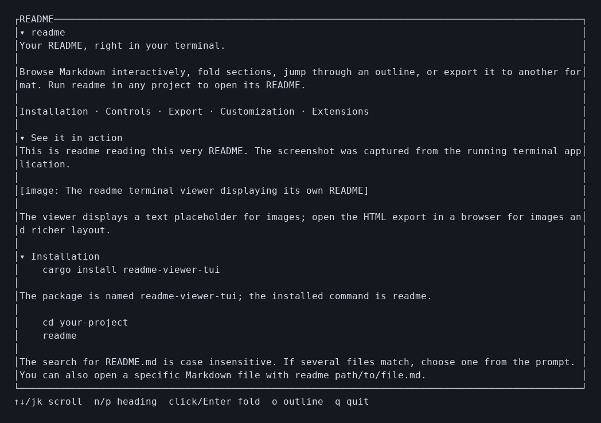

# readme

**Your README, right in your terminal.**

Browse Markdown interactively, fold sections, jump through an outline, or export it to another format. Run `readme` in any project to open its README.

[Installation](#installation) · [Controls](#controls) · [Export](#export) · [Customization](#customization) · [Extensions](#extensions)

## See it in action

This is `readme` reading **this very README**. The screenshot was captured from the running terminal application.



The viewer displays a text placeholder for images; open the HTML export in a browser for images and richer layout.

## Installation

```sh
cargo install readme-viewer-tui
```

The package is named `readme-viewer-tui`; the installed command is `readme`.

```sh
cd your-project
readme
```

The search for `README.md` is case insensitive. If several files match, choose one from the prompt. You can also open a specific Markdown file with `readme path/to/file.md`.

## Controls

| Action | Mouse | Keyboard |
| --- | --- | --- |
| Scroll | Wheel | `↑` / `↓`, `j` / `k`, Page Up / Down |
| Fold or unfold a section | Click its heading | `n` / `p` to jump to a heading, then Enter or Space |
| Open or close the outline | — | `o` |
| Jump to a section from the outline | — | `↑` / `↓`, then Enter |
| Close the outline or quit | — | `q` or Escape |

Folding hides the section's contents and nested headings. The outline lists all headings, including those inside folded sections.

## Export

All output goes to standard output, so it can be redirected or piped.

```sh
readme --static                  # rendered text
readme --raw                     # original Markdown
readme --json > readme.json      # structured JSON
readme --yaml > readme.yaml      # structured YAML
readme --toml > readme.toml      # structured TOML
readme --html > readme.html      # styled, standalone HTML
readme --html --raw > source.html # Markdown source inside an HTML page
```

JSON, YAML and TOML contain the source path, Markdown and a list of headings. `--raw` bypasses extensions; in structured exports it preserves the original Markdown. `--html --raw` escapes the source into a preformatted block.

## Customization

Create `~/.config/readme/config.toml` (or the platform's configuration directory):

```toml
heading_color = "cyan"
text_color = "white"
# html_css = "body { font: 18px sans-serif; max-width: 60em; margin: auto; }"
extensions = ["my-filter"]
```

Available colors: `black`, `red`, `green`, `yellow`, `blue`, `magenta`, `cyan`, `white`. The optional `html_css` replaces the default HTML stylesheet.

## Extensions

An extension is an executable that reads UTF-8 Markdown from standard input and writes transformed UTF-8 Markdown to standard output.

```sh
readme install ./my-filter   # install a local executable
readme extensions            # list installed extensions
readme uninstall my-filter   # remove it
```

Add its filename to `extensions` in the config to enable it. Extensions run in the listed order for rendering and structured exports, except with `--raw`. They run with your user permissions, so install only code you trust.

## Development

```sh
cargo test
cargo clippy -- -D warnings
cargo run -- --static
```

Released under the [MIT License](LICENSE).
